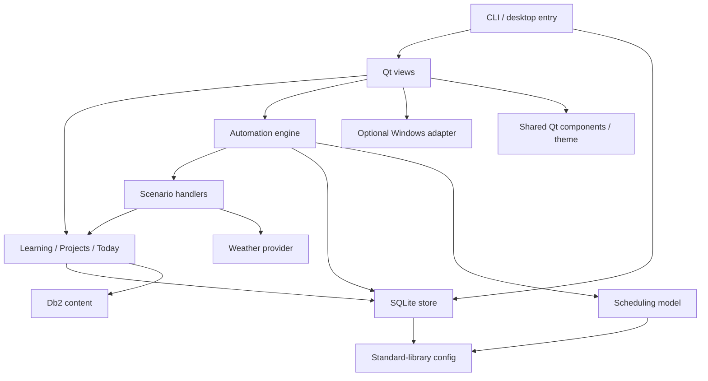

# Архитектура

## Общая поставка (0.9.0)

`automation_defaults.py` — выключенные стандартные шаблоны; `preferences_service.py` — portable-настройки первого запуска; `onboarding_ui.py` — Qt welcome и системный IANA-пояс. `app_config.timezone_from_settings` объединяет правило пояса интерфейса для UI/Today/Agenda: выбранное место, иначе user_timezone, иначе UTC. Существующие задачи имеют собственный пояс и не переписываются общей настройкой.

`release_layout.py` поставляет только публичную справку из release_docs, не контекст разработки. `Orbita.spec` задаёт переносимую сборку относительно SPECPATH. Данные создаются отдельно от программы. Для свежего Windows-профиля используется Orbita, прежняя существующая база автоматически сохраняет старый путь. Mutex из Windows-адаптера разделяет явно указанные каталоги данных. Подробности, миграция 7 → 8 и проверки: [DISTRIBUTION.md](DISTRIBUTION.md).

## Производительность (0.8.0)

Схема 7 добавляет только индексы. `store.latest_runs(db)` использует индексированный поиск на задачу и участвует в общем read transaction. UI читает `get_settings()` одним снимком, преобразует метки в уже загруженный IANA-пояс и не перестраивает скрытую ленту. `feed_dirty`/`visual_dirty` обеспечивают обновление при восстановлении окна.

Планировщик передаёт пачку кандидатов `_enqueue_batch`, не открывает пишущую транзакцию, если все слоты уже есть; UNIQUE остаётся арбитром конкурирующих процессов. `_dispatch` фильтрует готовность в SQL и повторно проверяет её под `BEGIN IMMEDIATE` перед захватом. Карта задач переиспользуется внутри прохода, но не кэшируется между проходами и пробуждениями.

Статическая поверхность окна кэшируется по размеру и devicePixelRatio; прозрачные пиксели сохраняются в QPixmap. Сцены `WeatherArt` останавливаются при скрытии/минимизации, не рисуются за viewport и выключаются настройкой `animations`. Большие списки Qt создаются порциями; сервис проектов сохраняет прежний API без limit, а UI запрашивает нужную часть. Подробности: [PERFORMANCE.md](PERFORMANCE.md).

## Границы слоёв

| Слой | Файлы | Ответственность |
|---|---|---|
| Конфигурация | `app_config.py` | Версия, совместимый offset хранения, каталоги данных/программы/документов |
| Модель расписаний | `automation_models.py` | Проверка расписания, последний/следующий слот, результат обработчика |
| Выполнение | `automation_engine.py` | Очередь, аренды, конкуренция, восстановление, фиксация результата |
| Сценарии | `automation_handlers.py`, `weather.py` | Прогноз, напоминание, аудит, выбор учебного занятия |
| Хранение | `desktop_store.py` | SQLite, резервная копия/миграции, задачи, запуски, уведомления, действия |
| Прикладные сервисы | `learning_service.py`, `project_service.py`, `today_service.py`, `agenda_service.py`, `weather_service.py` | Учебный процесс, проекты, текущий фокус, пассивный календарный план, погодный кэш по датам |
| Местоположение | `location_service.py` / `location_ui.py` | Portable-профиль/поиск/пояс / UI и системный Qt Positioning-адаптер |
| Учебный контент | `db2_content.py`, `training/db2` | Данные, задания, подсказки, эталоны и источники IBM |
| Desktop UI | `orbita_glass.py`, `today_ui.py`, `learning_ui.py`, `projects_ui.py` | Представление и действия пользователя |
| Общие UI-компоненты | `ui_components.py`, `ui_theme.py` | Карточки, кнопки, адаптивная навигация, защита сохранения, палитра |
| Windows-адаптер | `windows_integration.py` | HKCU Run и параметры подложки конкретного окна |
| Вход/упаковка | `orbita_entry.py`, `publish.py`, `build_desktop.py` | Лёгкий CLI, GUI, нативная desktop-сборка |

Историческое имя `desktop_store.py` не означает Windows-зависимость: это стандартная библиотека Python и SQLite. Учебные и проектные таблицы находятся в той же базе, но управляются отдельными сервисами. UI не должен выполнять прикладные SQL-запросы для обучения или работать с корпоративным сервером.

## Жизненный цикл

`orbita_entry.py --publish-file` обрабатывает файл без загрузки Qt/планировщика. Обычный запуск создаёт QApplication, главное окно и Engine. Ядро проверяет очередь каждые 5 секунд в отдельном потоке. UI отслеживает счётчик `revision`; скрытое окно опрашивается реже, погодная отрисовка останавливается. «Сегодня» пересчитывается при изменении данных/минуты и при открытии вкладки; карточка не перестраивается при неизменной модели.

Ограничение одного GUI-экземпляра пока реализовано в Windows через mutex. В других desktop-ветвях отдельный межпроцессный механизм ещё не добавлен. При нативном переносе это обязательная проверка, несмотря на существующую дедупликацию плановых слотов в SQLite.

Закрытие главной панели прячет её в трей, при отсутствии трея — сворачивает. Полный выход сохраняет открытые учебные/проектные черновики, прекращает планирование и ожидает ограниченное время завершения обработчиков. Escape в редакторах тоже сохраняет текст. При ошибке сохранения редактор не закрывается.

## Поток результата

Расписание/ручной запрос → запись `runs` → захват арендой → обработчик возвращает `Result` → транзакционная запись события, настроек и статуса успеха → UI показывает событие с учётом тихого режима. Обработчик сам не открывает окна и не вызывает уведомления ОС. Сбой не заменяет сохранённый прогноз. Повтор обучения обновляет карточку того же занятия; журнал запусков остаётся отдельным.

Напоминание проекта дополнительно проверяется перед фиксацией: архив/пауза/перенастройка могут отменить уже готовящийся результат. Будущим внешним необратимым действиям нужны собственные правила идемпотентности; транзакция локальной базы сама по себе не гарантирует однократность стороннего API.

## Добавление направления

Новый сценарий получает portable-модель/обработчик и проверки, затем адаптер UI. Новый курс — отдельный каталог контента и расширение выбора курса; сейчас сервис обучения поддерживает только `db2`. Новая платформа реализует жизненный цикл, пути, упаковку и доставку, сохраняя данные и состояния. Не импортируйте Qt/Win32 в прикладные сервисы ради удобства одной кнопки.

## Геолокация и календарное время

Новый слой описан в [GEOLOCATION.md](GEOLOCATION.md). IANA/DST принадлежит portable-модели расписаний, системные разрешения/координаты — Qt-адаптеру. Startup fix запускается только при сохранённом opt-in и открытой панели. HTTP — вне UI-потока. Погодный ответ фиксируется только при совпадении location fingerprint в транзакции. Read model «Сегодня» версии 2 возвращает IANA-имя пояса.

## Следующий календарный день (0.7.0)

`agenda_service.snapshot()` вычисляет пассивный план в календарных границах выбранного места, используя все слоты `automation_models.occurrences()`. Никаких вызовов Engine из чтения плана нет. `weather_service` выбирает прогноз по точной дате и fingerprint, `WeatherPanel` переиспользуется на обеих страницах, `TomorrowPage` живёт в `day_ui.py`. Метки хранения остаются совместимыми; схема 6. Новый маршрут `--tomorrow` не меняет старые страницы/ID/JSON. Полное описание: [TOMORROW.md](TOMORROW.md).

## Установка Windows (0.9.2)

Inno Setup — внешний адаптер поставки, ядро и SQLite не вызываются. GUI держит дополнительный InstallGuard для Setup/Uninstall; отдельные профили по-прежнему разделены собственным instance mutex. Закрытие через трей использует прежний путь сохранения черновиков и ожидания engine.stop. Установщик требует полного выхода и не завершает процесс принудительно. Стабильный AppId и политика хранения описаны в INSTALLER.md.
